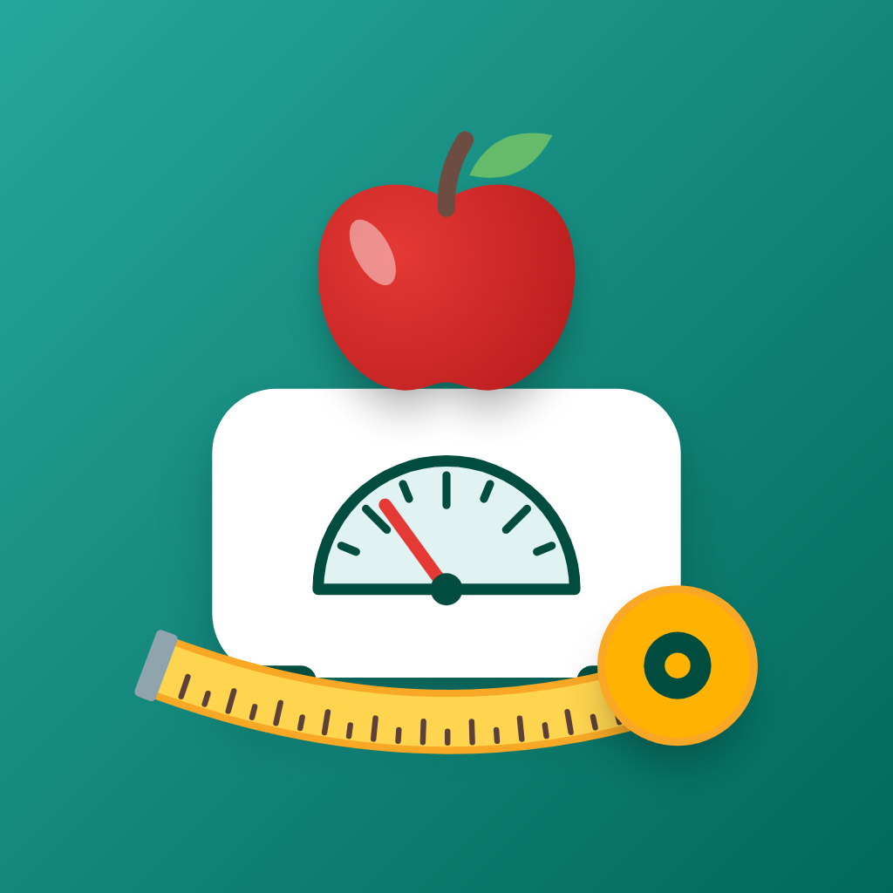

<p align="center">
  
</p>

# BiteScale

A simple Android app for losing (or gaining) weight with a calorie deficit.
Track your weight and the food you eat, and BiteScale tells you how much you
can still eat today to reach your weight goal on time.

Everything stays on your phone. No account, no ads, no internet needed.

## Features

**Weight**
- Log your weight and see it on a graph with a trend line. A slider picks how
  far back the graph goes, from 4 days to your whole history.
- BMI from your height, or body fat % with the U.S. Navy tape-measure method.
- Set a goal weight and date, and see how fast you need to go.

**Food**
- A daily calorie target based on your body, activity level and goal.
- A bar that shows how much you can still eat, and whether you are still in a
  calorie deficit.
- Your own food list with photos, categories, nutrients and portion sizes
  ("1 slice = 30 g").
- Favourites for one-tap logging, and a pie chart of where today's calories
  came from.
- Share foods with a friend who also has BiteScale, or export/import them as a
  file. Importing never deletes anything you already have.

**Languages:** English and Finnish (Suomi).

---

## Get the app on your Android phone

Works on Android 7.0 or newer, so practically any phone from 2017 onwards.

### Option A: download the ready-made app (easiest, no computer skills needed)

1. On your phone, open this project's
   [**Releases page**](../../releases/latest) and tap **`BiteScale.apk`** to
   download it.
2. Open the downloaded file (from the notification, or **Files → Downloads**).
3. Android will say it blocks apps from unknown sources. Tap **Settings**,
   turn on **Allow from this source**, then go back and tap **Install**.
   (BiteScale isn't on the Play Store, which is why Android asks this.)
4. If **Play Protect** warns about an unknown app, tap **More details →
   Install anyway**.
5. Open **BiteScale** from your app list.

### Option B: build it yourself from the code

You need a Windows, macOS or Linux computer and about 30 minutes for the
first-time setup.

**1. Install the tools (only once)**

1. Install **Flutter** by following the official guide for your computer:
   <https://docs.flutter.dev/get-started/install>. Choose **Android** as the
   app type when it asks.
2. Install **Android Studio**: <https://developer.android.com/studio>. Open
   it once and let it download the Android SDK.
3. Accept the Android licences and check that everything is OK:

   ```bash
   flutter doctor --android-licenses
   ```

   ```bash
   flutter doctor
   ```

   The **Flutter** and **Android toolchain** lines should have a green tick.
   Others (Chrome, Visual Studio, Xcode) don't matter for this app.

**2. Get the code**

Download it with **Code → Download ZIP** on this page and unzip it, or with
git:

```bash
git clone https://github.com/IHateThisMap/bitescale.git
```

Then open a terminal in the project folder.

**3. Put it on your phone**

*With a USB cable (installs straight onto the phone):*

1. On the phone, turn on **Developer options**: open **Settings → About
   phone** and tap **Build number** seven times.
2. In **Settings → System → Developer options**, turn on **USB debugging**.
3. Connect the phone with a USB cable and tap **Allow** on the phone when it
   asks.
4. Run:

   ```bash
   flutter run --release
   ```

   The app installs and opens on the phone. It stays there after you
   unplug the cable.

*Without a cable (build a file and copy it over):*

```bash
flutter build apk --release
```

This creates `build/app/outputs/flutter-apk/app-release.apk`. Send that file
to your phone (email, Google Drive, USB…) and install it as in Option A,
steps 2–5.

### Updating and your data

- Your weights and foods are saved inside the app on the phone. **Uninstalling
  the app deletes them**, so use **My foods → ⋮ → Export foods** first if you
  want to keep your food list.
- Installing a newer APK over the old one keeps your data, **as long as both
  were built on the same computer**. Each computer signs apps with its own
  development key, and Android refuses to update an app with a different key.
  If you get "App not installed", it's this: export your foods, uninstall
  the old app, then install the new one.

## Ready-made food lists

Don't want to type in every food yourself? The [`food_files`](food_files)
folder has files that can be imported to the application. These files have
some products from Finnish food stores because I live in Finland. When 
importing, you can pick and choose what foods to import from the file. Many
of the foods in the files should be perfectly usable in other countries too:

- [`bitescale-foods-en.json`](food_files/bitescale-foods-en.json) – in English
- [`bitescale-foods-fi.json`](food_files/bitescale-foods-fi.json) – suomeksi

To add them:

1. Open the file link above on your phone and tap the **download** button
   (↓, top right of the file view).
2. In BiteScale, go to **Food → My foods (📖) → ⋮ → Import foods** and pick
   the downloaded file.
3. Untick any foods you don't want and tap **Import … foods**. Foods you already
   have are never deleted or changed unless you choose so.

---

## How the code is organized

BiteScale is a [Flutter](https://flutter.dev) app written in Dart. All app
code is in `lib/`:

```
lib/
├── main.dart              Starts the app; theme and language
├── models/                The data: what a food, weight entry and profile are
│   ├── food.dart            Food, FoodLogEntry (one eaten food), Nutrients
│   ├── user_profile.dart    Height, goal, sex, measurements, activity level
│   └── weight_entry.dart
├── screens/               Full pages
│   ├── app_shell.dart       Bottom navigation between Weight and Food
│   ├── height_setup_screen  Asked on first start
│   ├── weight_screen        Weight graph, BMI/body fat, goal
│   ├── food_log_screen      What was eaten today, calorie target
│   ├── food_library_screen  "My foods" / "Add food" list
│   ├── food_edit_screen     Create or edit one food
│   ├── import_foods_screen  Review foods before importing them
│   └── share_foods_screen   Choose foods to send to someone
├── widgets/               Smaller pieces and dialogs used by the screens
├── services/              Saving and loading
│   ├── *_storage.dart       Data saved on the phone (shared_preferences)
│   ├── food_image_service   Food photos
│   ├── food_transfer        Food file format, import duplicate checks
│   ├── food_sharing         Opens the phone's share menu
│   └── incoming_files       Food files opened with the app (Android)
├── utils/                 Calculations, no UI
│   ├── calorie_target.dart  Daily calories: BMR → maintenance → target
│   ├── body_metrics.dart    BMI and U.S. Navy body fat
│   ├── trend.dart           Weight trend line
│   ├── time_range.dart      Weight graph slider ranges
│   ├── dates.dart
│   └── format.dart          Number formatting ("72,5" in Finnish)
└── l10n/                  Translations (see "Languages" below)
```

A good place to start reading is `screens/app_shell.dart`, then the two main
screens. The maths behind the calorie target is explained at the top of
`utils/calorie_target.dart`.

Receiving shared food files on Android also needs a bit of native code in
`android/app/src/main/kotlin/.../MainActivity.kt`.

### Running the tests

```bash
flutter test
```

`tool/` contains helper scripts that are run like tests: one draws the app
icon, the others render preview images of single widgets.

## Languages

The app is available in English and Finnish. The language can be changed
with the translate icon in the top bar; "System default" follows the phone.

All texts live in `lib/l10n/`, one file per language:

- `app_en.arb` – English, the main file. New texts are added here first.
- `app_fi.arb` – Finnish.

### Adding a language

1. Copy `app_en.arb` to `app_<code>.arb`, for example `app_sv.arb` for
   Swedish, and change `"@@locale"` to the new code.
2. Translate every text. Set `"languageName"` to the language's own name
   (e.g. `"Svenska"`); the language picker shows it automatically. Entries
   starting with `@` are notes for translators and can be removed.
3. Run `flutter gen-l10n` (or just run the app) and `flutter test`. The
   tests fail if the new file is missing any text that English has.

Texts with `{days, plural, ...}` change with the number; keep the
`=1{...}` and `other{...}` parts and translate the text inside them.

## Disclaimer

The calorie numbers are estimates from standard formulas (Mifflin-St Jeor,
Katch-McArdle, U.S. Navy). They are not medical advice. Talk to a doctor
before starting a big diet change.
